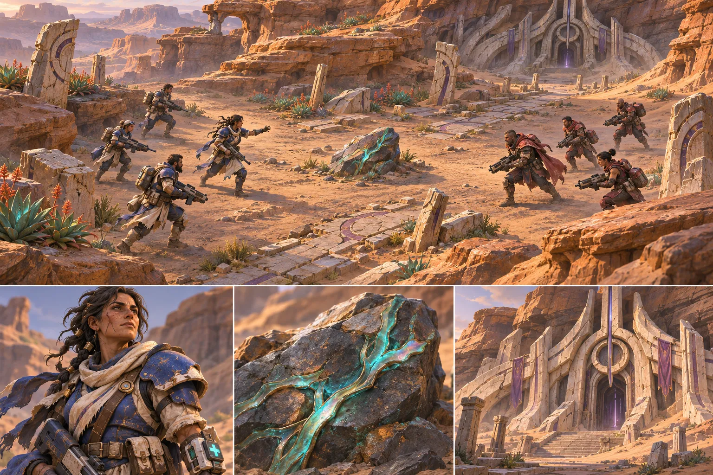

# Balance

A real-time strategy game in tribute to **Dune II** (1992), with the warmth of fantasy: closer to *The Lord of the Rings* and *Star Wars* than to modern military. Two factions, democratic **Blue** and authoritarian **Red**, fight over **Orichalcum**, the scarce crystal that pays for every army. They fight ten years after a coup killed the Peacebringer king. Blue is led by his exiled son; Red by the lieutenant who killed him.

The RTS is the heart of the game. HD-2D walking sequences (an Octopath-style canyon, with *Streets of Rage 4*-style fights) and illustrated storyboard briefings carry the story between missions.



## Read first

| Document | For |
| --- | --- |
| [`docs/GAME_DESIGN.md`](docs/GAME_DESIGN.md) | The game: story, factions, Mission 1, gameplay pillars, look and feel, open questions |
| [`AGENTS.md`](AGENTS.md) | How the project is built: repository layout, working rules, current builds and next steps. All coding agents start here. |
| [`docs/`](docs/) | Visual rubric, experiment log, pipeline, style bible |

## Run

Open the folder in **Godot 4.7.2** and press Play, or run:

```powershell
& "C:\Godot\Godot_v4.7.2-stable_win64.exe" --path .
```

The opening screen leads to the **Developers Page**, which lists every playable build and study. Esc returns to it.

Under **Forest builds**, **2D Painted Forest Walk** follows the Blue Commander through a buttress-root entrance, fern grove, wooded rise and sunlit clearing. [Study, paintings and recording](assets/scenes/forest_test/REPORT.md)

The experimental **Pixel Canyon** builds are listed under Canyon builds. [Two-Room Study](docs/PIXEL_CANYON_STUDY.md) introduces the painted rooms and combat test. [Camera and Depth](docs/PIXEL_CANYON_CAMERA_STUDY.md) compares three ways to frame the first room. [Through the Bend](docs/PIXEL_CANYON_FOLLOW_STUDY.md) proves a continuous two-way walk and records why the moving cutout scenery failed.

[Session B](docs/PIXEL_CANYON_SESSION_B.md) tests a fixed-angle bend with a foreground wall. [Painted Bend](docs/PIXEL_CANYON_SESSION_B_PAINTED.md) compares three paintings and puts the selected art on the same playable route.

## Status

Early prototype. RTS Mission 1 (*The First Claim*) has a drivable tank on the desert map and a modular kitbash mini-map. The RPG canyon approach has a route-driven 3D scene (`scenes/maps/canyon_v2.tscn`).

Everything shipped must be original or properly licensed.
